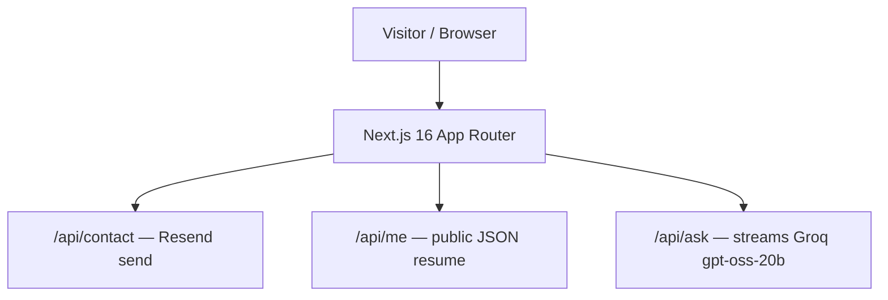

# STATE — <!-- updated: 2026-10-17 -->

## Current focus
The **FIELD** portfolio: a single fixed-viewport, six-chapter site on a custom
smooth-scroll stage, a 2D-canvas particle "field" behind everything, and a wine
curtain between chapters. Palette "Bone paper & wine". No Three.js on the page.

## Shape

## Done
- **FIELD build + exact-source reconciliation** (from `design_handoff_portfolio_field/`;
  the `.dc.html` is source of truth): `field/{data,canvas,chapters,Field}.tsx` + full
  `globals.css`. rAF scroll engine (wheel/touch/keys), particle field (6 formations,
  "Nodes and threads"), scroll-window reveals + parallax, counters, branch-draw, curtain
  560/190/720, nav rail, progress rail. Plain CSS, no Tailwind.
- **Old design removed:** deleted the dark/R3F components, content, hooks, data; pruned
  deps (three/R3F, framer-motion, gsap, lenis, next-themes, tailwind, shadcn kit). Kept
  `src/lib/portfolio-data.ts` (feeds `/api/me`).
- **Build 01 — cursor / first load / transitions:** ring+dot+label cursor (4 states,
  hidden on touch), eased preloader (1500/500ms), `navigate()` curtain with spam-guard +
  keyboard 1–5/Esc + hash sync; reload on `/#work` inits without a curtain.
- **Build 02 — element specs** (`BUILD-02-elements.md`, 9 sections): fixed the work-panel
  scroll bug (`trackPanel` re-measures range per frame → settles `height:auto`);
  plain-words Work copy; header keyhint+ticker+blink (dropped "Open to work"); hero /
  About / nav-rail spacing; open-C arc monogram.
- **Build 03 — mobile chapter bar:** `MobileChapterBar.tsx`, bottom-fixed 6 cells at
  `≤720px` (rail hidden), sliding indicator via `ResizeObserver`, 56px targets, safe-area
  padding, `.fld-chapter` bottom clearance.
- **Backend simplified to Resend:** removed Convex entirely; `/api/contact` sends the mail
  directly (honeypot + validation, escaped HTML, `replyTo` sender). Dropped `convex`/`zod`
  deps; `vercel.json` back to framework default. Stripped stale Convex notes from
  CLAUDE.md / AGENTS.md.
- **SEO / crawlability / security:** full metadata in `layout.tsx` (title, description,
  canonical, robots index/follow, Open Graph, Twitter card, `metadataBase`) + Person
  JSON-LD; `app/robots.ts` → `/robots.txt`, `app/sitemap.ts` → `/sitemap.xml`,
  `app/opengraph-image.tsx` (dynamic bone-&-wine social card), branded `not-found.tsx`.
  URLs centralised in `src/lib/site.ts`. Every chapter now has an `<h2>` (one `<h1>` =
  hero, `aria-label`led); nav chapter links are real `<a href="#…">` (mobile bar, always
  in DOM); content is static-prerendered semantic HTML, canvas is `aria-hidden`.
  Contact route: IP rate limit (5/10min, in-memory) + newline-stripped name + escaped
  HTML. Verified live: robots/sitemap/OG 200, metadata + JSON-LD present, 6th POST → 429.
- **Launched on the custom domain:** live at `https://www.chaitanyaparasana.com` (bought
  at Spaceship; `www` primary, apex 308→www, HTTPS). Canonical/OG/sitemap point to www via
  `NEXT_PUBLIC_APP_URL` + the `site.ts` default. Google + Bing verified (meta tags),
  sitemap submitted, indexing requested. Vercel Analytics + Speed Insights on. Branded
  open-C favicon (`icon.svg` + `apple-icon`, bone bg), OG description trimmed to 141/113
  chars. Lighthouse: Accessibility 100 / SEO 100.
- **Real work screenshots + Key Projects pass:** dropped real screenshots into
  `public/work/` (AI Platform, ScoreDay, Vellum PNGs + `orient.svg` hero). Work frames now
  render the whole image uncropped (`object-fit: contain`, own full-width row, reserved
  `width`/`height` so the JS-driven panel grows to fit; dropped `loading="lazy"` which never
  fired inside the transformed scroll stage) with per-image `alt`. Hover preview card now
  shows the same thumbnail (image fills the card, label in a bottom strip, shimmer off when
  an image is present). Renamed chapter 02 **Selected Work → Key Projects** (heading + rail
  label). Roadmap: added **Armor** (CodeRabbit-style AI code reviewer) to *Building now*,
  header count Four → Five. Contact budget now starts at **₹10k**. Verified live, deployed.
- **SEO audit fixes:** hero `<h1>` text content was `ChaitanyaParasana` (two char-split
  spans + ` `, no whitespace node) → added a space node so it reads "Chaitanya Parasana"
  (strongest on-page signal; visual line break unchanged); same fix on the `Let's talk`
  contact `<h2>`. Removed `/api/me` from `sitemap.ts` (it's `Disallow`ed in robots.txt, so a
  sitemap entry threw a Search Console conflict). Broadened `SITE_TITLE` to `… · Hyderabad`
  (adds locus, differentiates from an identical competitor title). Verified in the built
  HTML. Left canonical trailing-slash alone (root-domain `…com` ≡ `…com/`, already
  consistent with og:url). Off-page authority + a content-page decision remain manual.
- **Copy + count consistency (Oct):** hero and contact availability now "Available this
  quarter". Project count is 4 everywhere (hero metric, About sentence + its highlight split
  in `chapters.tsx`, Build numbers, Recognition counter).
- **Hero "Ask about my work" assistant (ADR-0009 → ADR-0010):** `Ask.tsx` under the intro
  row streams from `/api/ask` (Groq free tier, `openai/gpt-oss-20b` via plain `fetch`;
  grounded in `field/data.ts`, cached system prompt, no tools; first built on Claude Haiku
  5.5, switched to Groq to cost $0) and shows the measured "first word in Nms". Per-IP limit moved to shared
  `src/lib/rate-limit.ts` (contact 5, ask 15 per 10 min). Verified locally: 400 on bad input,
  500 with a clear message when the key is unset, 429 from request 16, digits typed in the
  box don't trigger chapter hotkeys, no mobile overflow (row padded clear of the progress
  rail label). Build + lint clean.
- **Assistant live-tested locally with a Groq key:** streams, facts match the site, first
  word 275 to 680ms; declines off-topic and injection, says "don't know" (no invention) for
  facts not on the site, follows multi-turn context. Caching hit ~1 in 3, so a 429 now falls
  back across 3 free models (burst of 5 parallel questions: all answered). Em dashes are
  stripped on the stream.
- **Reddit build log:** `LINKS.reddit` / `SOCIALS.reddit` (u/Chaitanya299) shown as a
  "Build log" link in Contact, added to Person JSON-LD `sameAs`, and given to the assistant.
- Earlier: CI/CD (Docker, k8s, Actions), `/api/me` + `/api/health`.

## Decisions (docs/decisions/)
0006 FIELD engine · 0007 remove Convex → direct Resend (supersedes 0002) · 0008 SEO /
static-HTML rendering strategy · 0009 Ask assistant on Claude Haiku 5.5 (superseded) ·
0010 Ask assistant on the Groq free tier. See
`docs/ARCHITECTURE.md` for the current shape.

## Next up
- Add `GROQ_API_KEY` to Vercel (Production + Preview) and redeploy; ask one live question.

## Blocked / needs research
- None open.

## Known issues
- None open.
