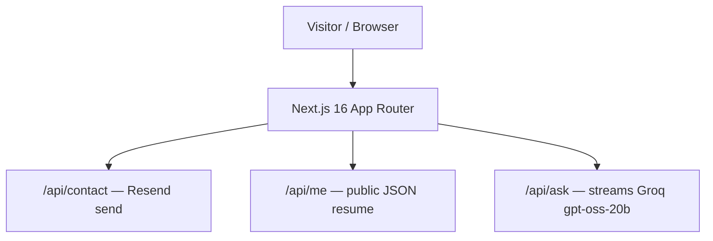

# STATE — <!-- updated: 2026-10-26 -->

## Current focus
The **FIELD v3** portfolio: one native-scroll page (hero, About, five chapters) with a fixed
header chapter pill (bottom bar on phones), a 2D-canvas particle "field" behind everything,
and a wine curtain on nav clicks and when scrolling into chapters 01–05. Palette "Bone paper
& wine". No Three.js on the page. Live at `https://www.chaitanyaparasana.com`.

## Shape

## Done
- **FIELD v3 (Oct 26, `82c8c63`):** rebuilt from Claude Design `Portfolio - FIELD v3.dc.html`
  (source in `design_handoff_portfolio_field/v3/`). `Markup.tsx` = the design markup generated
  verbatim (inline styles; `style-hover`/`style-focus` → `!important` classes in
  `globals.css`), server-rendered. `Field.tsx` runs `engine.ts` (port of `field-engine.js`) +
  `setup.ts` (chapters/curtain, header tuck, rise, work preview, lift, ask, contact form)
  after fonts load. Removed the custom scroll stage, preloader, nav rail, MobileChapterBar,
  `chapters.tsx`, `canvas.ts`, `Ask.tsx`. New: Stafflo "Now" block (demo shots from
  stafflo.ai); sentence-style Ask streaming `HEADLINE:`/`BODY:` from `/api/ask` (design's
  canned answers as fallback; timing line dropped; cost questions quote the budget ranges);
  contact form on `/api/contact` with honeypot. Build lists 4 services ("Four things"). Work +
  Recognition aside labels are `<h2>`. `data.ts` now only grounds the assistant (v3 copy +
  Stafflo facts). Verified live: h1, canonical, JSON-LD, viewport-fit, robots/sitemap/OG/
  health 200, `/api/ask` 200, a production contact send 200.
- **Assistant (ADR-0009 → 0010):** `/api/ask` on the Groq free tier (plain `fetch`, cached
  grounding prompt, no tools), falls back across 3 free models on 429, em dashes stripped
  on the stream; shared `src/lib/rate-limit.ts` (contact 5, ask 15 per 10 min). Live in
  production since Oct 17 (`GROQ_API_KEY` in Vercel); declines off-topic/injection.
- **SEO / launch:** custom domain (`www` primary, apex 308), full metadata + Person JSON-LD,
  `robots.ts`, `sitemap.ts` (no `/api/me`), dynamic OG image, branded `not-found` + favicon,
  `SITE_TITLE … · Hyderabad`, h1 reads "Chaitanya Parasana". Google + Bing verified, sitemap
  submitted; Vercel Analytics + Speed Insights; Lighthouse A11y 100 / SEO 100 (pre-v3).
- **Backend:** Convex removed (ADR-0007); `/api/contact` sends via Resend (honeypot,
  validation, escaped HTML, `replyTo`, per-IP limit).
- Earlier (summarised): FIELD v1/v2 builds 01–03 on the custom stage (superseded by v3);
  old dark/R3F design and deps removed; real work screenshots in `public/work/`; Reddit
  build log in Contact + JSON-LD `sameAs`; CI/CD (Docker, k8s, Actions); `/api/me` +
  `/api/health`.

## Decisions (docs/decisions/)
0006 FIELD engine · 0007 remove Convex → direct Resend (supersedes 0002) · 0008 SEO /
static-HTML rendering strategy · 0009 Ask assistant on Claude Haiku 5.5 (superseded) ·
0010 Ask assistant on the Groq free tier. See `docs/ARCHITECTURE.md` for the current shape.

## Next up
- Record an ADR for v3: native scroll + generated design markup replace the custom stage
  (supersedes the stage parts of 0006); update `ARCHITECTURE.md` to match.
- Hero metric says "500ms"; production first word measured 561 to 835ms warm. With the
  timing line gone from the Ask box, decide whether to keep the claim or adjust the copy.
- Re-run Lighthouse on the v3 page (last 100/100 was the old stage build).

## Blocked / needs research
- None open.

## Known issues
- Not browser-tested on v3: reduced-motion mode and dual-screen (viewport-segments) layout.
- Copy edits now go in the generated `Markup.tsx` and, for assistant facts, `data.ts`;
  the two can drift.
